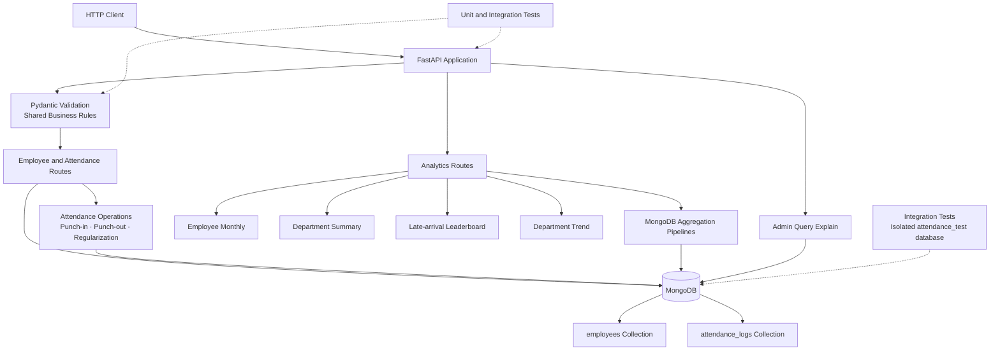

# Candidate kit

Read in this order:

1. `PROBLEM_STATEMENT.docx`: what you are asked to do, how it is evaluated.
2. `openapi.yaml`: the API contract and the business rules (R1 - R10).
3. `DATA_MODEL.md`: what is stored in MongoDB, with nine sample documents.
4. `app/main.py`: the starter. Put **all** your code in this one file. It must start with `uvicorn app.main:app --port 8000`.
5. `REVIEW.md`, `DECISIONS.md`: templates to fill in.

`sample_data/` holds the nine sample documents as MongoDB Extended JSON; `sample_seed.py` loads them. The grader's dataset is
much larger and contains cases they do not show.

## Local setup
```bash
python -m venv .venv && source .venv/bin/activate
pip install -r requirements.txt
cp .env.example .env            # set MONGO_URI and a disposable MONGO_DB (local docker: docker run -p 27017:27017 mongo:7)
# Set ALLOW_DESTRUCTIVE_SEED=true in .env, then run the replacement seed:
python sample_seed.py
uvicorn app.main:app --port 8000 --reload
```
MongoDB **6.0 or newer** is required (the grader uses 7.0). MongoDB Atlas free tier (M0) works.

`sample_seed.py` replaces the contents of both `employees` and
`attendance_logs`. It requires the explicit `ALLOW_DESTRUCTIVE_SEED=true`
opt-in and a dedicated disposable development database; it always rejects
`attendance_db`. Do not run it against shared, production, or grader data.

## Architecture



### API layer

FastAPI route handlers expose employee, attendance, analytics, health, and
admin explain endpoints. Pydantic request models and shared validators enforce
the documented employee, timestamp, date, month, and status formats before
route logic runs.

### Data layer

PyMongo connects to the database selected by `MONGO_URI` and `MONGO_DB`.
`employees` stores employee identity, department, shifts, and join dates;
`attendance_logs` stores one record per employee and attendance date, including
stored derived attendance values and regularization history. Startup creates
unique employee and attendance natural-key indexes plus indexes supporting
department, date, and employee-month queries.

### Business logic

Punch-in calculates the IST attendance day and late minutes. Punch-out uses a
conditional update so only one concurrent request can close a record.
Regularization recomputes derived fields, appends an audit entry, and uses an
optimistic history-length check so concurrent corrections cannot overwrite one
another. Datetimes are normalized at the MongoDB boundary and returned as
epoch milliseconds.

### Analytics and diagnostics

Monthly employee analytics, department summaries, the late-arrival leaderboard,
and department trends run through MongoDB aggregation pipelines. The trend
pipeline performs database-side date densification and moving averages. The
admin explain endpoint builds the same endpoint-specific find or aggregation
commands and requests MongoDB `executionStats` for diagnostics.

### Testing

Unit tests exercise validators and calculation helpers. Integration tests use
FastAPI's test client against a fresh uniquely named `attendance_test_<uuid>`
MongoDB database, with concurrency and endpoint behavior covered separately
from the production or development `attendance_db` database.

## Testing
Install the runtime and test-client dependencies, then run the unit and integration suites:

```powershell
pip install -r requirements.txt
pip install -r tests/requirements.txt
python -m unittest discover -s tests -v
python -m unittest tests.test_integration -v
```

Integration tests use a fresh, uniquely named `attendance_test_<uuid>` database and require the Docker MongoDB instance at `mongodb://[::1]:27017`. They must never target `attendance_db`.

## Benchmark notes

`benchmark_100k.py` uses an isolated Docker database named
`attendance_test_benchmark_<uuid>`. The measured local run contained 250
employees and 98,821 attendance records. Warmed endpoint averages ranged from
2.763 ms to 57.857 ms across five endpoints, and no `COLLSCAN` stages were
observed in the five explain targets.

These are local measurements, not a production performance guarantee. The
script does not provide formal concurrent-load testing and leaves the generated
database in place. Never point it at `attendance_db`.

## Submit
A public Git repository with `app/main.py`, `requirements.txt`, `REVIEW.md`, `DECISIONS.md` and a short `README.md`.
No `.env`, no secrets, no Dockerfile.
